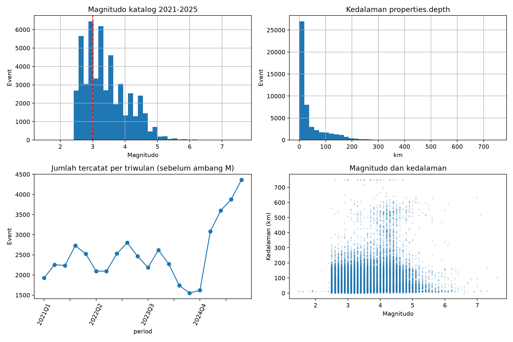
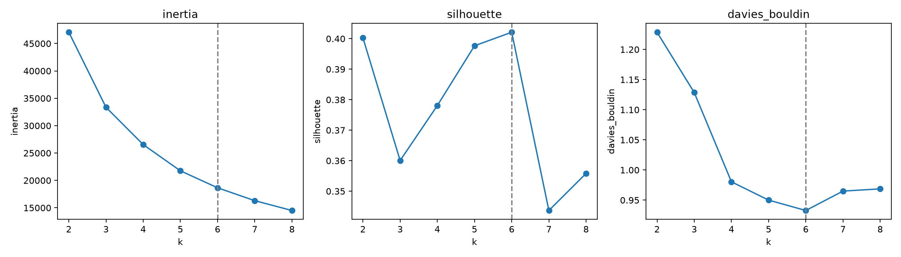
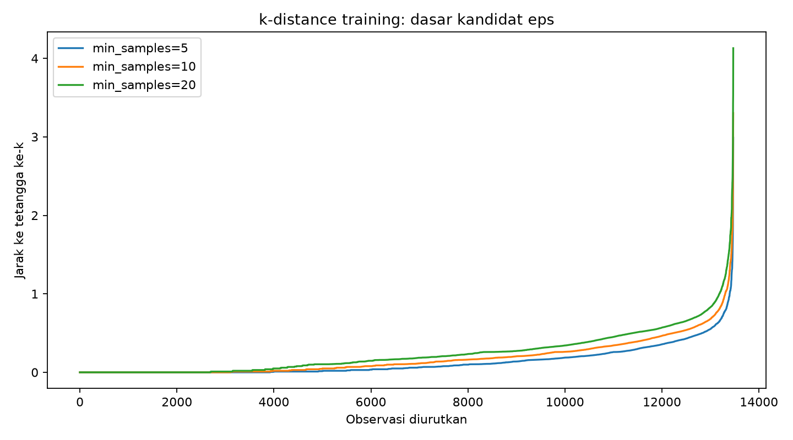
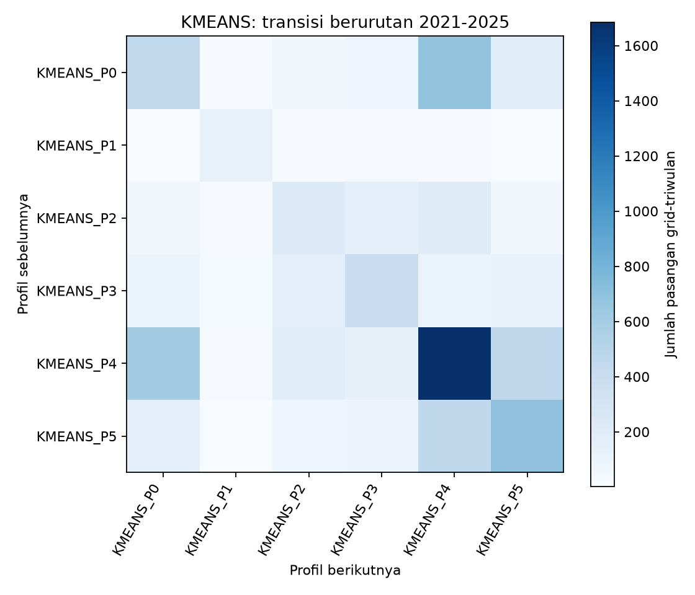

# Laporan Teknis dan Angka Penelitian Aktivitas Seismik

Untuk memahami tujuan dan makna hasil terlebih dahulu, baca [penjelasan utama proyek](LAPORAN_ALUR_DAN_HASIL_PENELITIAN.md). Dokumen teknis ini menyimpan rincian angka dan pemeriksaan sumber.

**Training 2021-2025 dan testing temporal 2026**  
Snapshot data: pengunduhan EMSC pada 26 Oktober 2026. Batas pengamatan adalah sebelum **26 Oktober 2026 pukul 00.00 UTC**, setara 08.00 WITA. Laporan ini disusun dari file hasil eksekusi yang tersimpan, bukan angka ilustrasi. Perubahan data atau konfigurasi memerlukan pembaruan laporan.

Dokumen ini menjelaskan apa yang dilakukan pada setiap tahap, berapa hasil aktualnya, mengapa suatu keputusan dibuat, bagaimana membaca hasilnya, dan notebook yang menjadi rujukan. Istilah teknis dijelaskan pada saat digunakan.

## Daftar isi

1. [Tujuan dan gambaran hasil](#1-tujuan-dan-gambaran-hasil)
2. [Urutan notebook](#2-urutan-notebook)
3. [Data collection](#3-data-collection)
4. [Data preprocessing](#4-data-preprocessing)
5. [EDA](#5-eda)
6. [K-Means](#6-k-means)
7. [DBSCAN](#7-dbscan)
8. [Perbandingan model](#8-perbandingan-model)
9. [Penamaan dan interpretasi kelompok](#9-penamaan-dan-interpretasi-kelompok)
10. [Perubahan profil historis](#10-perubahan-profil-historis)
11. [Uji kestabilan dan sensitivitas](#11-uji-kestabilan-dan-sensitivitas)
12. [Testing 2026](#12-testing-2026)
13. [GIS dan cara membaca peta](#13-gis-dan-cara-membaca-peta)
14. [Verifikasi eksekusi](#14-verifikasi-eksekusi)
15. [Temuan dan batas kesimpulan](#15-temuan-dan-batas-kesimpulan)
16. [Daftar keluaran dan referensi](#16-daftar-keluaran-dan-referensi)

## 1. Tujuan dan gambaran hasil

Penelitian ini mengelompokkan **karakteristik aktivitas gempa suatu wilayah pada suatu triwulan**. Satu baris model adalah satu kotak wilayah pada satu periode tiga bulan. Penelitian tidak mengelompokkan setiap kejadian gempa secara langsung.

Data 2021-2025 digunakan untuk menemukan kelompok historis. Data 2026 dipakai untuk memeriksa kecocokan kelompok tersebut terhadap pengamatan baru. Ini tetap **unsupervised learning**, yaitu pembentukan kelompok tanpa label target yang telah ditentukan. Kata training berarti proses pembentukan model; testing berarti penerapan dan pemeriksaan pada periode baru.

Hasil utama yang sudah diperoleh:

| Tahap | Hasil aktual |
| --- | --- |
| Collection | 78.265 catatan kejadian dari API |
| Cleaning | 78.213 kejadian lolos; 52 ditolak |
| Ambang magnitudo | 50.198 kejadian M >=3 untuk agregasi |
| Training | 13.471 observasi grid-triwulan layak dari 1.758 grid historis |
| K-Means | k=6 terpilih menurut aturan eksperimen; mean Silhouette seleksi 0,4021 |
| DBSCAN | 7 cluster; eps=0,505041; min_samples=20; noise 9,04% |
| Testing lengkap | 2.625 observasi layak pada Januari-September 2026 |
| Testing parsial | 298 observasi layak pada Oktober 2026 sampai batas pengamatan |
| GIS | 4 peta HTML interaktif dan 2 file geometri GeoJSON |

Angka Silhouette pada tabel ini berasal dari **rata-rata tiga sampel untuk seleksi parameter**. Bagian evaluasi di bawah memakai satu sampel tetap sehingga nilainya sedikit berbeda. Ini dua cara pelaporan pada model yang sama, bukan dua eksperimen dengan data berbeda.

## 2. Urutan notebook

Alur pengerjaan adalah **collection -> preprocessing -> EDA -> K-Means dan DBSCAN -> evaluasi -> analisis perubahan -> sensitivitas -> testing -> GIS**. Artefak setiap tahap disimpan agar tahap sesudahnya dapat membaca hasilnya tanpa mengulang unduhan.

| No. | Notebook | Tujuan |
| --- | --- | --- |
| 00 | [Panduan dan environment](notebooks/00_panduan.ipynb) | Memeriksa kernel, pustaka, dan konfigurasi |
| 01 | [Data collection](notebooks/01_data_collection/01_data_collection.ipynb) | Mengambil katalog EMSC dan mencatat cakupan |
| 02 | [Data preprocessing](notebooks/02_data_preprocessing/02_data_preprocessing.ipynb) | Membersihkan data serta membuat panel dan scaler |
| 03 | [EDA](notebooks/03_eda/03_eda.ipynb) | Memahami distribusi, katalog, dan korelasi |
| 04 | [K-Means](notebooks/04_kmeans/04_kmeans.ipynb) | Memilih k dan membentuk kelompok centroid |
| 05 | [DBSCAN](notebooks/05_dbscan/05_dbscan.ipynb) | Menguji eps/min_samples dan menemukan kelompok kepadatan |
| 06 | [Model evaluation](notebooks/06_model_evaluation/06_model_evaluation.ipynb) | Membandingkan struktur kelompok dan cakupan |
| 07 | [Analisis temporal](notebooks/07_temporal_analysis/07_temporal_analysis.ipynb) | Mengukur perpindahan dan durasi profil |
| 08 | [Stability](notebooks/08_stability/08_stability.ipynb) | Memeriksa pengaruh perubahan pengaturan |
| 09 | [Testing 2026](notebooks/09_testing_2026/09_testing_2026.ipynb) | Menerapkan model historis pada data baru |
| 10 | [GIS mapping](notebooks/10_gis_mapping/10_gis_mapping.ipynb) | Mengembalikan hasil ke polygon dan peta |

Konfigurasi dapat diperiksa di [config.json](config.json). Kernel yang digunakan adalah **Python 3.12.11 (Seismic Research)**. Notebook asli `ml_20206 (1).ipynb` tidak ditulis oleh pipeline baru.

## 3. Data collection

**Rujukan:** [01 Data collection](notebooks/01_data_collection/01_data_collection.ipynb), khususnya bagian definisi atribut, pengunduhan bulanan, dan audit cakupan.

### 3.1 Sumber dan atribut data

Katalog diambil melalui EMSC/SeismicPortal FDSN Event service. Atribut yang disimpan meliputi waktu UTC, lintang, bujur, kedalaman, magnitudo, jenis magnitudo, tipe kejadian, ID kejadian, wilayah deskriptif, author, dan waktu revisi. Wilayah permintaan dibatasi lintang -11 sampai 6 dan bujur 95 sampai 141.

Batas tersebut merupakan **bounding box Indonesia dan sekitarnya**. Ini mencakup laut serta sebagian wilayah tetangga, sehingga bukan pemotongan menurut batas administratif negara.

### 3.2 Pengambilan dan pemeriksaan cakupan

Permintaan dipecah per bulan. Terdapat **70 interval pengunduhan** dari Januari 2021 sampai Oktober 2026; Oktober hanya sampai cutoff. Cache JSON menyimpan respons sumber, URL permintaan dan waktu pengambilan. Retry menangani kegagalan sementara. Jika jumlah respons mencapai limit 20.000, kode membagi interval lagi untuk menghindari hasil terpotong. Kegagalan tidak dicatat sebagai nol kejadian.

**Kedalaman diambil dari `properties.depth` dalam km.** `geometry.coordinates[2]` disimpan sebagai `geometry_z` untuk audit. Pada respons yang diperiksa tanda keduanya berlawanan, sehingga koordinat ketiga tidak dipakai langsung sebagai kedalaman.

### 3.3 Hasil pengunduhan

Collection berhasil menyimpan **78.265 catatan API**. Catatan ini belum semuanya dipakai untuk model: tipe kejadian, validitas data dan ambang magnitudo diperiksa sesudah pengunduhan.

| Tahun | Catatan API | Lolos cleaning | Dipakai (M >=3) | Peran |
| --- | --- | --- | --- | --- |
| 2021 | 9.148 | 9.148 | 7.189 | Training, satu tahun penuh |
| 2022 | 9.248 | 9.248 | 6.984 | Training, satu tahun penuh |
| 2023 | 10.118 | 10.070 | 7.485 | Training, satu tahun penuh |
| 2024 | 7.188 | 7.184 | 5.601 | Training, satu tahun penuh |
| 2025 | 14.922 | 14.922 | 8.887 | Training, satu tahun penuh |
| 2026 | 27.641 | 27.641 | 14.052 | Testing, sampai sebelum 26 Oktober |

Baris 2026 belum mencakup setahun penuh. Jumlah 2026 tidak boleh langsung dibandingkan dengan tahun penuh sebagai bukti kenaikan aktivitas.

**Bukti dan keluaran:** [events.csv](data/raw/events.csv), [manifest collection](data/raw/collection_manifest.json), dan [folder respons bulanan](data/raw/monthly/). Seluruh interval permintaan tercatat berhasil. Hal itu membuktikan cakupan unduhan, tetapi belum membuktikan semua gempa fisik telah terdeteksi oleh katalog.

## 4. Data preprocessing

**Rujukan:** [02 Data preprocessing](notebooks/02_data_preprocessing/02_data_preprocessing.ipynb). Cleaning terdapat pada bagian 3, grid pada bagian 4, dan standardisasi pada bagian 5.

### 4.1 Cleaning dan pemilihan event

Waktu dikonversi ke UTC dengan dukungan format pecahan detik yang berbeda. Koordinat, waktu dan cakupan diperiksa. ID duplikat mempertahankan revisi terakhir; event tanpa ID memakai kunci atribut agar tidak semuanya dianggap satu duplikat. Depth di luar 0-800 km ditandai hilang; magnitudo di luar -2 sampai 10 juga ditandai hilang.

Tipe kejadian yang diterima adalah `ke`, `fe`, dan `de`. Pada snapshot ini, seluruh kejadian yang lolos bertipe `ke`. Terdapat **44 catatan `ue` dan 8 catatan `uk`**, sehingga **52 catatan tidak diterima**. File rejected mencatat alasannya sebagai `event_type_not_accepted`.

Hasil cleaning adalah **78.213 kejadian**. Pada snapshot ini tidak ditemukan baris duplikat yang dibuang, nilai kosong pada waktu/koordinat/depth/magnitudo dalam data bersih, atau depth yang ditandai tidak valid. Pernyataan ini berlaku untuk hasil pemeriksaan kode, bukan jaminan semua pengukuran sumber tanpa kesalahan.

Analisis utama memakai **magnitudo minimal 3,0**. Setelah ambang tersebut diterapkan, tersisa **50.198 kejadian**, terdiri dari **36.146 kejadian historis** dan **14.052 kejadian testing**. Sebanyak 28.015 kejadian bersih berada di bawah ambang dan tidak masuk agregasi utama. Ambang 3,0 bersifat eksploratif, belum merupakan hasil pembuktian completeness katalog.

### 4.2 Membentuk kotak wilayah dan periode

Grid utama berukuran **50 x 50 km pada bidang proyeksi LAEA**, berpusat di 118 BT dan -2,5 LS. Origin grid tetap, sehingga letak kotak tidak bergeser saat data baru masuk. Satu sel interior mempunyai luas 2.500 km² pada bidang equal-area; panjang sisi geodesiknya tidak tepat sama di semua lokasi.

Setiap kejadian dimasukkan ke kotak dan triwulannya. Untuk training, semua **20 triwulan** dari 2021Q1 sampai 2025Q4 dilengkapi pada **1.758 grid yang pernah aktif historis**. Testing mencakup 1.839 grid, termasuk **81 grid baru pada 2026**. Penambahan grid testing tidak mengubah universe training.

### 4.3 Membedakan nol kejadian dan fitur belum lengkap

`NO_EVENTS` berarti tidak ada kejadian M >=3 tercatat pada kotak-periode itu. Count dan frekuensi menjadi nol, tetapi rata-rata magnitudo dan depth tetap kosong. `INCOMPLETE_FEATURES` berarti ada kejadian tetapi fitur belum memenuhi syarat. `ELIGIBLE` berarti fitur lengkap dan depth coverage minimal 80%, sehingga baris dapat masuk clustering.

| Bagian data | Grid unik | Periode | Semua baris panel | Layak clustering | Nol kejadian | Fitur belum lengkap |
| --- | --- | --- | --- | --- | --- | --- |
| Training 2021-2025 | 1.758 | 20 | 35.160 | 13.471 | 21.689 | 0 |
| Testing Q1-Q3 2026 | 1.839 | 3 | 5.517 | 2.625 | 2.892 | 0 |
| Testing Q4 2026 parsial | 1.839 | 1 | 1.839 | 298 | 1.541 | 0 |

Total panel adalah **42.516 baris grid-triwulan**. Jumlah ini berbeda dari 50.198 kejadian gempa: beberapa event dapat bergabung menjadi satu baris, dan baris nol kejadian tetap ditambahkan untuk analisis waktu. Pada snapshot ini tidak ada baris berstatus fitur belum lengkap.

### 4.4 Fitur dan standardisasi

| Fitur model | Arti | Pengolahan |
| --- | --- | --- |
| `log_frequency` | Seberapa sering gempa tercatat | log1p(jumlah kejadian / bulan pengamatan) |
| `avg_magnitude` | Magnitudo rata-rata dalam kotak-periode | Mean magnitudo event |
| `max_magnitude` | Magnitudo terbesar dalam kotak-periode | Maksimum magnitudo event |
| `avg_depth` | Kedalaman rata-rata dalam kotak-periode | Mean depth valid, dalam km |
| `shallow_fraction` | Proporsi kejadian depth <70 km | Dibagi jumlah event dengan depth valid |

Pada triwulan lengkap, frekuensi per bulan adalah count/3. Triwulan parsial memakai durasi pengamatan dalam bulan ekuivalen 30,4375 hari. Count, density dan frekuensi mentah tidak sekaligus menjadi fitur jarak karena mengulang informasi. Koordinat tidak menjadi fitur clustering, sehingga kelompok dapat berisi wilayah yang berjauhan namun aktivitasnya mirip.

**StandardScaler hanya di-fit pada 13.471 baris training layak.** Scaler memusatkan dan menyetarakan skala fitur agar satuan km tidak otomatis mendominasi jarak. Testing hanya ditransformasi menggunakan scaler historis. Tidak ada pengisian nol untuk statistik magnitudo/depth yang kosong.

**Keluaran:** [data bersih](data/processed/events_clean.csv), [data ditolak](data/processed/events_rejected.csv), [event beserta grid](data/processed/events_with_grid.csv), [panel](data/processed/panel.csv), [fitur standar](data/processed/features_scaled.csv), [transformasi tersimpan](data/processed/transform.joblib), dan [metadata preprocessing](data/processed/metadata.json).

## 5. EDA

**Rujukan:** [03 EDA](notebooks/03_eda/03_eda.ipynb). EDA berarti pemeriksaan awal untuk memahami isi dan kualitas data sebelum menafsirkan cluster. Keputusan model menggunakan EDA historis 2021-2025.

Pada 50.572 kejadian historis bersih **sebelum filter M >=3**, magnitudo rata-ratanya **3,41**, median **3,30**, dan rentangnya **1,5 sampai 7,6**. Kedalaman rata-rata **48,92 km**, median **15,00 km**, dan rentangnya **0 sampai 750 km**. Angka ini adalah statistik event, bukan rata-rata profil cluster.

### 5.1 Korelasi fitur

Korelasi menunjukkan seberapa bersama-sama dua fitur berubah. Pada baris training layak, korelasi `avg_magnitude` dan `max_magnitude` adalah **0,8044**, sedangkan `avg_depth` dan `shallow_fraction` adalah **-0,7488**. Pasangan pertama masih membawa informasi berulang; pasangan kedua berkaitan karena semakin dalam mean depth biasanya semakin kecil proporsi dangkal. Standardisasi tidak menghilangkan korelasi ini. Pengaruh pemilihan fitur masih perlu diperiksa sebelum kesimpulan final.

Sumber: [matriks korelasi](reports/evaluation/feature_correlation.csv). Audit lain tersedia pada [jumlah dan karakter katalog per tahun](reports/evaluation/catalogue_by_year.csv), [author katalog](reports/evaluation/catalogue_authors.csv), dan [jenis magnitudo](reports/evaluation/magnitude_types.csv).

### 5.2 Kelengkapan pencatatan

Notebook membandingkan jumlah pada ambang M 2,5; 3,0; 3,5; dan 4,0. Mode histogram magnitudo dengan bin 0,1 juga dicatat sebagai diagnostik awal:

| Tahun | Mode histogram M | Ambang analisis M | Ambang di bawah mode? |
| --- | --- | --- | --- |
| 2021 | 3,1 | 3,0 | Ya |
| 2022 | 3,0 | 3,0 | Tidak |
| 2023 | 3,0 | 3,0 | Tidak |
| 2024 | 3,0 | 3,0 | Tidak |
| 2025 | 2,5 | 3,0 | Tidak |

Mode histogram ini **bukan estimasi magnitude of completeness yang telah tervalidasi**. Pada 2021, ambang 3,0 berada di bawah mode histogram 3,1; hal itu menjadi alasan tambahan untuk memeriksa kelengkapan. Jenis magnitudo juga belum dihomogenisasi menjadi Mw. Perubahan pencatatan, author atau jenis magnitudo dapat memengaruhi jumlah dan profil yang ditemukan.

Keluaran pemeriksaan: [audit ambang magnitudo](reports/evaluation/magnitude_threshold_audit.csv) dan [diagnostik completeness](reports/evaluation/completeness_diagnostic.csv).

## 6. K-Means

**Rujukan:** [04 K-Means](notebooks/04_kmeans/04_kmeans.ipynb); pencarian k pada [bagian 4](notebooks/04_kmeans/04_kmeans.ipynb#s4), hasil fitting pada [bagian 5](notebooks/04_kmeans/04_kmeans.ipynb#s5).

### 6.1 Pembentukan kelompok dengan K-Means

K-Means mencari pusat kelompok atau centroid. Setiap observasi grid-triwulan ditempatkan pada centroid terdekat di ruang lima fitur standar. Semua 13.471 baris training layak digabungkan dalam satu fitting historis, sehingga makna kelompok dapat digunakan secara konsisten antartriwulan.

Jumlah kelompok tidak langsung dipaksa tiga. Kandidat **k=2 sampai 8** diuji menggunakan `n_init=20` dan random_state 42. Dua puluh inisialisasi membantu pencarian centroid, sedangkan seed membuat eksperimen dapat diulang.

### 6.2 Aturan pemilihan k

Silhouette menilai kedekatan suatu observasi dengan kelompoknya dibanding kelompok lain; lebih tinggi menunjukkan pemisahan geometris yang lebih baik. Davies-Bouldin Index (DBI) menilai kemiripan antarkelompok; lebih rendah lebih baik. Inertia mengukur jumlah kuadrat jarak ke centroid; digunakan untuk melihat pola elbow, bukan sebagai satu-satunya penentu karena nilainya umumnya turun saat k bertambah.

Aturan kode adalah memilih **rata-rata Silhouette tertinggi** dari tiga sampel, masing-masing maksimal 2.000 baris (seed 42, 7, dan 21). Jika sama, DBI lebih rendah lalu k lebih kecil menjadi pemecah seri. SD yang dilaporkan mengukur variasi antar-sampel skor, bukan interval kepercayaan inferensial.

| k | Inertia | Mean Silhouette | SD antar-sampel | DBI |
| --- | --- | --- | --- | --- |
| 2,0000 | 47.061,79 | 0,4003 | 0,0115 | 1,2286 |
| 3,0000 | 33.350,95 | 0,3601 | 0,0025 | 1,1285 |
| 4,0000 | 26.543,78 | 0,3781 | 0,0004 | 0,9804 |
| 5,0000 | 21.756,09 | 0,3977 | 0,0016 | 0,9500 |
| 6,0000 | 18.653,13 | 0,4021 | 0,0033 | 0,9328 |
| 7,0000 | 16.299,47 | 0,3437 | 0,0044 | 0,9650 |
| 8,0000 | 14.506,74 | 0,3558 | 0,0012 | 0,9687 |

### 6.3 Hasil yang dipilih

**k=6 terpilih sebagai nilai terbaik menurut aturan eksperimen ini**, dengan mean Silhouette **0,402108**, SD **0,003344**, DBI **0,932800**, dan inertia **18.653,13**. Keenam cluster memuat seluruh 13.471 baris layak; kelompok terkecil berisi 536 baris dan kelompok terbesar sekitar 41,04%.

Penyebutan **k optimal** harus dibatasi pada kandidat, fitur, data dan aturan ini. Skor k=2 (**0,400265**) sangat dekat dengan k=6. Oleh karena itu, hasil ini belum membuktikan bahwa alam mempunyai tepat enam tipe aktivitas atau k=6 unggul secara statistik atas semua alternatif.

Visual proyeksi cluster tersedia pada [PCA K-Means](reports/figures/kmeans_pca.png). PCA merangkum lima fitur menjadi dua sumbu untuk visualisasi; dua sumbu tersebut bukan lintang-bujur dan bukan ruang tempat model di-fit.

**Keluaran:** [seluruh kandidat k](models/kmeans/parameter_search.csv), [model K-Means](models/kmeans/model.joblib), [label training](models/kmeans/training_labels.csv), [profil statistik](models/kmeans/profiles.csv), dan [metadata pemilihan](models/kmeans/metadata.json).

## 7. DBSCAN

**Rujukan:** [05 DBSCAN](notebooks/05_dbscan/05_dbscan.ipynb); pencarian parameter pada [bagian 3](notebooks/05_dbscan/05_dbscan.ipynb#s3) dan hasil pada [bagian 4](notebooks/05_dbscan/05_dbscan.ipynb#s4).

### 7.1 Pembentukan kelompok dengan DBSCAN

DBSCAN mencari kelompok berdasarkan kepadatan titik di **ruang fitur aktivitas**, bukan langsung jarak geografis antarepisenter. Parameter `eps` menentukan radius tetangga pada fitur standar; `min_samples` menentukan dukungan minimum untuk suatu core point. Observasi yang tidak terhubung ke struktur kepadatan dapat berstatus noise. Noise bukan otomatis daerah berbahaya.

Kandidat `min_samples` adalah **5, 10, dan 20**. Kandidat eps diambil dari kuantil 0,50; 0,70; 0,85; dan 0,95 jarak tetangga ke-k pada training. Query tetangga memasukkan titik itu sendiri, konsisten dengan perhitungan min_samples. Total terdapat **12 kombinasi** yang diuji.

### 7.2 Penilaian skor, noise, dan fragmentasi

Screening training menerima kandidat dengan 2-20 cluster, cluster terkecil minimal 20 observasi, noise maksimal 50%, dan cluster terbesar maksimal 95% data assigned. Batas ini adalah kebijakan analitis untuk menghindari dominasi satu cluster atau ratusan kelompok kecil. Batas tersebut disusun dari diagnosis training, bukan ketentuan alami seismologi. Pengaruhnya diuji pada notebook 08.

Silhouette/DBI DBSCAN dihitung pada titik yang assigned, tanpa noise. Karena cakupannya dapat berbeda, skor harus selalu dibaca bersama noise dan ukuran cluster.

| eps | min_samples | Cluster | Ukuran terkecil | Noise | Mean Silhouette | DBI | Lolos screening? |
| --- | --- | --- | --- | --- | --- | --- | --- |
| 0,053797 | 5 | 251 | 4 | 46,67% | 0,6045 | 0,4916 | Tidak |
| 0,160168 | 5 | 146 | 3 | 26,16% | 0,2344 | 1,1374 | Tidak |
| 0,291550 | 5 | 51 | 3 | 11,55% | -0,1119 | 1,6099 | Tidak |
| 0,491201 | 5 | 14 | 4 | 3,04% | -0,0403 | 1,5833 | Tidak |
| 0,104398 | 10 | 95 | 5 | 45,48% | 0,4976 | 0,9728 | Tidak |
| 0,224183 | 10 | 68 | 10 | 24,89% | 0,2196 | 1,6639 | Tidak |
| 0,387934 | 10 | 19 | 11 | 10,39% | -0,0367 | 2,2547 | Tidak |
| 0,610008 | 10 | 2 | 479 | 2,54% | -0,0769 | 4,6543 | Tidak |
| 0,172769 | 20 | 42 | 12 | 43,18% | 0,3666 | 1,0604 | Tidak |
| 0,303197 | 20 | 14 | 20 | 24,04% | -0,0382 | 2,0595 | Ya |
| 0,505041 | 20 | 7 | 28 | 9,04% | 0,1294 | 2,0116 | Ya |
| 0,732817 | 20 | 1 | 13.162 | 2,29% | Tidak terdefinisi | Tidak terdefinisi | Tidak |

### 7.3 Hasil yang dipilih

Kandidat terpilih adalah **eps=0,505041 dan min_samples=20**, menghasilkan **7 cluster**, **12.253 observasi assigned**, dan **1.218 noise (9,04%)**. Mean Silhouette seleksi **0,129396** dan DBI **2,011581**. Cluster terkecil berisi 28 observasi.

Kandidat dengan Silhouette sekitar 0,6045 menghasilkan **251 cluster** dan cluster terkecil hanya 4 observasi, sehingga gagal screening. Angka tinggi tersebut tidak dijadikan alasan mengabaikan fragmentasi. Dua kandidat lolos screening; model terpilih memiliki mean Silhouette lebih tinggi di antara keduanya. Status `diagnostic_only=false` berarti ada kandidat yang lolos aturan kode, **bukan sertifikat validitas ilmiah**.

**Keluaran:** [seluruh kombinasi parameter](models/dbscan/parameter_search.csv), [model DBSCAN](models/dbscan/model.joblib), [label training](models/dbscan/training_labels.csv), [profil statistik](models/dbscan/profiles.csv), [PCA DBSCAN](reports/figures/dbscan_pca.png), dan [metadata](models/dbscan/metadata.json).

## 8. Perbandingan model

**Rujukan:** [06 Model evaluation](notebooks/06_model_evaluation/06_model_evaluation.ipynb), terutama [bagian 2-3 untuk evaluasi](notebooks/06_model_evaluation/06_model_evaluation.ipynb#s2).

### 8.1 Evaluasi pada training layak

Pada tabel ini, K-Means memakai semua observasi training layak. DBSCAN melaporkan noise pada semua observasi, tetapi metrik jarak hanya memakai observasi yang assigned. Sampel Silhouette menggunakan seed tetap 42, maksimal 2.000 baris; ini menjelaskan perbedaan kecil dari mean tiga sampel di tabel seleksi.

| Metode | Baris input | Assigned | Tidak assigned | Silhouette | DBI |
| --- | --- | --- | --- | --- | --- |
| kmeans | 13.471 | 13.471 | 0,00% | 0,3987 | 0,9328 |
| dbscan | 13.471 | 12.253 | 9,04% | 0,1261 | 2,0116 |

### 8.2 Perbandingan pada observasi yang sama

Agar perbandingan lebih setara, kedua model dievaluasi kembali pada **12.253 baris yang sama**, yaitu baris assigned DBSCAN. Cakupannya **90,96%** dari training layak.

| Metode | Baris input | Assigned | Tidak assigned | Silhouette | DBI |
| --- | --- | --- | --- | --- | --- |
| kmeans | 12.253 | 12.253 | 0,00% | 0,4257 | 0,8665 |
| dbscan | 12.253 | 12.253 | 0,00% | 0,1261 | 2,0116 |

Dalam konfigurasi yang diuji, **K-Means mempunyai pemisahan cluster lebih baik menurut Silhouette dan DBI**, termasuk pada subset identik. Kesimpulan ini berlaku pada ruang fitur dan kandidat sekarang. Ini bukan akurasi terhadap kebenaran geologi dan tidak menyatakan K-Means selalu lebih baik untuk semua data gempa.

Kesepakatan partisi K-Means dan DBSCAN pada subset assigned menghasilkan **ARI=0,2665**. ARI membandingkan apakah pasangan observasi dikelompokkan bersama oleh dua partisi. ARI 1 berarti partisi identik; angka lebih rendah menunjukkan perbedaan. Nilai 0,2665 menunjukkan kedua metode tidak menghasilkan pengelompokan yang sama, meskipun memakai fitur yang sama. Nomor cluster tidak perlu disamakan untuk menghitung ARI.

**Keluaran:** [perbandingan model](reports/evaluation/model_comparison.csv) dan [kesepakatan partisi](reports/evaluation/agreement.json).

## 9. Penamaan dan interpretasi kelompok

**Rujukan:** [04 K-Means bagian 6: aturan penamaan](notebooks/04_kmeans/04_kmeans.ipynb#s6) dan [bagian 7: tabel hasil nama](notebooks/04_kmeans/04_kmeans.ipynb#s7); [05 DBSCAN bagian 5: aturan penamaan](notebooks/05_dbscan/05_dbscan.ipynb#s5) dan [bagian 6: tabel hasil nama](notebooks/05_dbscan/05_dbscan.ipynb#s6).

Kelompok dibentuk terlebih dahulu oleh algoritma. Sesudah itu peneliti membaca statistik training lalu memberi **nama deskriptif**. Huruf A/B/C hanya pengenal kelompok. Nama tidak menjadi target training, tidak mengubah keanggotaan, dan tidak ditentukan dari testing 2026.

Fungsi `profile_descriptions()` menggunakan aturan penulisan yang terlihat dalam notebook: mean depth <70 km diringkas sebagai cenderung dangkal; kelompok dengan mean jumlah event terbesar di antara cluster metode itu dijelaskan sebagai kejadian lebih sering. Mean magnitudo dan depth ditulis pada nama/legenda untuk menjaga keterlacakan. Ini aturan **penerjemahan hasil**, bukan aturan pembentukan cluster.

### 9.1 Profil K-Means

| Kode | Nama deskriptif | Kejadian / 3 bulan | Mean M | Mean depth (km) | Baris pembentuk |
| --- | --- | --- | --- | --- | --- |
| KMEANS_P0 | Kelompok A: Cenderung dangkal, magnitudo sekitar 4,2 | 1,69 | 4,21 | 23,28 | 2.895 |
| KMEANS_P1 | Kelompok B: Kedalaman sekitar 468 km, magnitudo 4,2 | 1,22 | 4,24 | 467,64 | 536 |
| KMEANS_P2 | Kelompok C: Kedalaman sekitar 138 km, magnitudo 3,4 | 1,65 | 3,41 | 137,88 | 1.348 |
| KMEANS_P3 | Kelompok D: Kedalaman sekitar 145 km, magnitudo 4,2 | 2,41 | 4,23 | 145,44 | 1.407 |
| KMEANS_P4 | Kelompok E: Cenderung dangkal, magnitudo sekitar 3,4 | 1,68 | 3,35 | 19,59 | 5.528 |
| KMEANS_P5 | Kelompok F: Kejadian lebih sering; cenderung dangkal | 8,93 | 3,67 | 38,30 | 1.757 |

Contoh membaca Kelompok F: rata-rata sekitar **8,93 kejadian per kotak per triwulan**, mean magnitudo **3,67**, dan mean depth **38,30 km**. Karena jumlah rata-ratanya terbesar di antara enam cluster dan mean depth di bawah 70 km, nama ringkasnya menjadi **Kejadian lebih sering; cenderung dangkal**. Kejadian lebih sering tidak berarti risiko tertinggi.

### 9.2 Profil DBSCAN

| Kode | Nama deskriptif | Kejadian / 3 bulan | Mean M | Mean depth (km) | Baris pembentuk |
| --- | --- | --- | --- | --- | --- |
| DBSCAN_P0 | Kelompok A: Cenderung dangkal, magnitudo sekitar 3,7 | 1,00 | 3,66 | 18,53 | 4.860 |
| DBSCAN_P1 | Kelompok B: Kedalaman sekitar 144 km, magnitudo 3,9 | 2,91 | 3,93 | 144,34 | 459 |
| DBSCAN_P2 | Kelompok C: Kedalaman sekitar 209 km, magnitudo 3,9 | 1,00 | 3,88 | 208,79 | 1.730 |
| DBSCAN_P3 | Kelompok D: Kejadian lebih sering; cenderung dangkal | 3,70 | 3,61 | 23,42 | 4.538 |
| DBSCAN_P4 | Kelompok E: Kedalaman sekitar 75 km, magnitudo 3,7 | 2,00 | 3,69 | 74,99 | 467 |
| DBSCAN_P5 | Kelompok F: Kedalaman sekitar 95 km, magnitudo 3,6 | 3,32 | 3,63 | 95,03 | 171 |
| DBSCAN_P6 | Kelompok G: Kedalaman sekitar 285 km, magnitudo 4,2 | 2,00 | 4,17 | 285,08 | 28 |
| NOISE | Tidak masuk kelompok historis DBSCAN | 8,09 | 3,97 | 165,10 | 1.218 |

Baris NOISE adalah statistik observasi historis yang tidak masuk cluster; baris itu tidak diberi huruf sebagai kelompok baru. **Kelompok A K-Means tidak sama dengan Kelompok A DBSCAN.** Angka pada tabel adalah rata-rata ciri grid-triwulan historis, bukan janji bahwa setiap kotak-periode memiliki nilai persis sama.

**Keluaran nama yang mudah dibaca:** [tabel interpretasi K-Means](reports/evaluation/kmeans_profile_interpretation.csv), [tabel interpretasi DBSCAN](reports/evaluation/dbscan_profile_interpretation.csv), [penjelasan legenda K-Means](reports/evaluation/kmeans_profile_explanations.json), dan [penjelasan legenda DBSCAN](reports/evaluation/dbscan_profile_explanations.json). [Panduan membaca hasil](docs/cara_menjelaskan_hasil.md) membahas perbedaan antara kelompok hasil algoritma dan nama dari peneliti.

## 10. Perubahan profil historis

**Rujukan:** [07 Temporal analysis](notebooks/07_temporal_analysis/07_temporal_analysis.ipynb); definisi pasangan pada bagian 2, ekspor hasil pada bagian 3, dan riwayat kotak pada bagian 5.

### 10.1 Unit dan aturan perbandingan

Setiap grid dilacak sepanjang 20 triwulan historis. Pergantian dihitung hanya pada **dua triwulan berurutan yang sama-sama mempunyai kelompok cluster**. Nol event, fitur belum lengkap, noise, dan celah periode memutus rangkaian. Dengan demikian, berpindah dari NO_EVENTS ke suatu cluster tidak dihitung sebagai pergantian profil cluster.

Stability rate dihitung sebagai `1 - jumlah pergantian / jumlah pasangan yang dapat dibandingkan`. Jika tidak ada pasangan yang layak, nilainya tidak dihitung. Durasi bertahan dihitung dalam jumlah triwulan berturut-turut, bukan hari.

### 10.2 Hasil aktual

| Metode | Grid historis | Grid dengan pasangan layak | Pasangan layak | Pergantian | Median pasangan / grid | Median stability rate | Durasi terpanjang (triwulan) |
| --- | --- | --- | --- | --- | --- | --- | --- |
| kmeans | 1.758 | 1.091 | 7.827 | 4.268 | 2 | 47,06% | 20 |
| dbscan | 1.758 | 1.058 | 6.388 | 3.057 | 1 | 50,00% | 20 |

Jumlah pergantian adalah jumlah **pasangan grid-triwulan yang berubah**, bukan jumlah wilayah unik. Median stability rate dihitung hanya pada grid yang nilainya dapat dihitung. Median jumlah pasangan memakai seluruh grid historis. Median pasangan yang hanya 1-2 menunjukkan dukungan temporal banyak grid masih terbatas.

Stability rate DBSCAN tidak dapat langsung disebut lebih baik daripada K-Means karena DBSCAN mengecualikan noise dan menghasilkan lebih sedikit pasangan layak. Kedua metode juga memakai definisi kelompok yang berbeda.

### 10.3 Matriks transisi

Baris berarti kelompok sebelumnya; kolom berarti kelompok berikutnya. Nilai diagonal adalah bertahan di kelompok yang sama, sedangkan nilai di luar diagonal adalah pergantian. Huruf pada setiap matriks merujuk tabel nama metode yang sama pada bagian 9. Isi matriks adalah jumlah pasangan berurutan.

**KMEANS**

| Dari / ke | A | B | C | D | E | F |
| --- | --- | --- | --- | --- | --- | --- |
| A | 448 | 10 | 67 | 87 | 675 | 184 |
| B | 3 | 127 | 11 | 19 | 14 | 3 |
| C | 62 | 16 | 232 | 155 | 200 | 61 |
| D | 90 | 25 | 164 | 387 | 110 | 115 |
| E | 608 | 18 | 182 | 136 | 1.685 | 456 |
| F | 162 | 2 | 72 | 99 | 462 | 680 |

**DBSCAN**

| Dari / ke | A | B | C | D | E | F | G |
| --- | --- | --- | --- | --- | --- | --- | --- |
| A | 985 | 26 | 166 | 838 | 81 | 18 | 0 |
| B | 23 | 95 | 61 | 25 | 22 | 18 | 1 |
| C | 155 | 75 | 240 | 88 | 44 | 18 | 11 |
| D | 819 | 26 | 107 | 1.965 | 75 | 27 | 0 |
| E | 77 | 15 | 48 | 90 | 32 | 8 | 0 |
| F | 14 | 15 | 16 | 32 | 7 | 13 | 0 |
| G | 1 | 1 | 7 | 1 | 1 | 0 | 1 |

Misalnya, pada K-Means terdapat **675 pasangan A -> E**. Itu berarti pada 675 pasangan kotak-triwulan berurutan, label berganti dari ciri Kelompok A ke Kelompok E. Ini tidak menyatakan 675 wilayah berbeda atau 675 kejadian gempa. Matriks probabilitas adalah normalisasi hitungan empiris per baris, bukan model prediksi Markov yang sudah divalidasi.

**Keluaran:** [riwayat K-Means](reports/temporal/kmeans/history.csv), [kestabilan per grid K-Means](reports/temporal/kmeans/grid_stability.csv), [durasi K-Means](reports/temporal/kmeans/profile_spells.csv), [probabilitas transisi K-Means](reports/temporal/kmeans/transition_probabilities.csv), serta [folder hasil DBSCAN](reports/temporal/dbscan/). Matriks seluruh status, termasuk NO_EVENTS dan NOISE, tersedia sebagai `state_transitions.csv` pada masing-masing folder metode.

## 11. Uji kestabilan dan sensitivitas

**Rujukan:** [08 Stability](notebooks/08_stability/08_stability.ipynb). Seluruh eksperimen bagian ini menggunakan training 2021-2025. Data 2026 tidak dipakai untuk memilih parameter.

Tujuannya memeriksa apakah kelompok berubah ketika pengaturan diubah. ARI tinggi berarti partisi pada observasi yang sama lebih serupa. ARI bukan akurasi atau bukti bahwa mekanisme fisik telah teridentifikasi. Pengujian ini merupakan sensitivitas deskriptif, belum spatial block bootstrap atau interval ketidakpastian inferensial.

### 11.1 Seed, k, eps, dan min_samples

| Metode | Perubahan | Nilai | ARI semua baris | ARI assigned bersama | Assigned bersama |
| --- | --- | --- | --- | --- | --- |
| kmeans | n_clusters | 5 | 0,8941 | 0,8941 | 100,00% |
| kmeans | n_clusters | 6 | 1,0000 | 1,0000 | 100,00% |
| kmeans | n_clusters | 7 | 0,5755 | 0,5755 | 100,00% |
| kmeans | random_seed | 7 | 0,9933 | 0,9933 | 100,00% |
| kmeans | random_seed | 21 | 0,9924 | 0,9924 | 100,00% |
| kmeans | random_seed | 42 | 1,0000 | 1,0000 | 100,00% |
| kmeans | random_seed | 84 | 0,9947 | 0,9947 | 100,00% |
| kmeans | random_seed | 123 | 0,9924 | 0,9924 | 100,00% |
| dbscan | eps_and_min_samples | eps_x0.8;min_samples=10 | 0,7617 | 0,7702 | 89,47% |
| dbscan | eps_and_min_samples | eps_x0.8;min_samples=20 | 0,7262 | 0,7840 | 84,46% |
| dbscan | eps_and_min_samples | eps_x0.8;min_samples=40 | 0,6565 | 0,8158 | 77,05% |
| dbscan | eps_and_min_samples | eps_x1.0;min_samples=10 | 0,9496 | 0,9970 | 90,96% |
| dbscan | eps_and_min_samples | eps_x1.0;min_samples=20 | 1,0000 | 1,0000 | 90,96% |
| dbscan | eps_and_min_samples | eps_x1.0;min_samples=40 | 0,9182 | 0,9998 | 84,16% |
| dbscan | eps_and_min_samples | eps_x1.2;min_samples=10 | 0,8069 | 0,9084 | 90,96% |
| dbscan | eps_and_min_samples | eps_x1.2;min_samples=20 | 0,8366 | 0,9084 | 90,96% |
| dbscan | eps_and_min_samples | eps_x1.2;min_samples=40 | 0,9534 | 0,9776 | 90,48% |

K-Means dengan k tetap 6 relatif konsisten terhadap seed: ARI sekitar **0,9924-0,9947** untuk seed alternatif. Jika jumlah cluster diubah, kesamaan turun: k=5 menghasilkan ARI **0,8941**, sedangkan k=7 **0,5755**. Konsisten terhadap seed tidak sama dengan konsisten terhadap semua pilihan metodologi.

DBSCAN berubah ketika eps/min_samples diubah. ARI yang memasukkan noise dapat dipengaruhi kesamaan status noise; karena itu tersedia ARI hanya pada observasi yang assigned oleh kedua partisi, beserta cakupannya. ARI tinggi pada subset kecil atau satu cluster harus dibaca hati-hati.

### 11.2 Resolusi grid dan ambang magnitudo

Baris grid pada 25 km tidak identik dengan baris grid 50 km atau 100 km. Karena itu, label dipetakan kembali ke **event ID historis yang sama**, baru ARI dihitung pada event bersama. Ukuran ini bersifat **event-weighted**: wilayah dengan banyak event mempunyai pengaruh lebih besar, dan grid tanpa event tidak ikut perbandingan ini. Kolom overlap melaporkan bagian event acuan yang masih dibandingkan.

| Metode | Yang diubah | Nilai | Event bersama | Overlap event acuan | ARI termasuk noise | ARI assigned bersama |
| --- | --- | --- | --- | --- | --- | --- |
| kmeans | grid_km | 25,0 | 36.146 | 100,00% | 0,4428 | 0,4428 |
| dbscan | grid_km | 25,0 | 36.146 | 100,00% | 0,2184 | 0,1145 |
| kmeans | grid_km | 50,0 | 36.146 | 100,00% | 1,0000 | 1,0000 |
| dbscan | grid_km | 50,0 | 36.146 | 100,00% | 1,0000 | 1,0000 |
| kmeans | grid_km | 100,0 | 36.146 | 100,00% | 0,3193 | 0,3193 |
| dbscan | grid_km | 100,0 | 36.146 | 100,00% | 0,3183 | 0,1813 |
| kmeans | min_magnitude | 2,5 | 36.146 | 100,00% | 0,6456 | 0,6456 |
| dbscan | min_magnitude | 2,5 | 36.146 | 100,00% | 0,7244 | 0,8116 |
| kmeans | min_magnitude | 3,0 | 36.146 | 100,00% | 1,0000 | 1,0000 |
| dbscan | min_magnitude | 3,0 | 36.146 | 100,00% | 1,0000 | 1,0000 |
| kmeans | min_magnitude | 3,5 | 20.508 | 56,74% | 0,4537 | 0,4537 |
| dbscan | min_magnitude | 3,5 | 20.508 | 56,74% | 0,4018 | 0,2731 |
| kmeans | min_magnitude | 4,0 | 10.903 | 30,16% | 0,2351 | 0,2351 |
| dbscan | min_magnitude | 4,0 | 10.903 | 30,16% | 0,3624 | 0,2581 |

Saat konfigurasi sama dengan baseline (50 km dan M>=3), kontrol menghasilkan ARI **1,0**. K-Means pada grid 25 km mempunyai ARI **0,4428** dan pada 100 km **0,3193** terhadap baseline. Hasil ini menunjukkan ketergantungan pada resolusi, sehingga belum tepat menyebut seluruh profil stabil lintas ukuran grid. Perubahan ambang magnitudo juga mengubah partisi serta event yang dapat dibandingkan.

### 11.3 Dukungan jumlah kejadian per kotak

Pada training utama, **11.662 dari 13.471 baris (86,57%) hanya memuat 1-4 event**. Jika hanya satu event, mean dan maksimum magnitudo sama, sedangkan proporsi dangkal hanya 0 atau 1. Hal ini dapat menciptakan struktur geometris yang belum tentu mencerminkan profil regional yang kuat.

Eksperimen berikut memfilter training dengan dukungan minimal 1, 3, 5 dan 10 event, lalu fit ulang scaler dan model pada subset historis dengan k/eps/min_samples terpilih tetap. ARI dibandingkan pada baris grid-triwulan yang sama yang masih dipertahankan.

| Metode | Minimum event | Baris tersisa | Cakupan baseline | Cluster | Noise | ARI pada baris sama |
| --- | --- | --- | --- | --- | --- | --- |
| kmeans | 1 | 13.471 | 100,00% | 6 | 0,00% | 1,0000 |
| dbscan | 1 | 13.471 | 100,00% | 7 | 9,04% | 1,0000 |
| kmeans | 3 | 4.042 | 30,01% | 6 | 0,00% | 0,3309 |
| dbscan | 3 | 4.042 | 30,01% | 2 | 38,10% | 0,6388 |
| kmeans | 5 | 1.809 | 13,43% | 6 | 0,00% | 0,0671 |
| dbscan | 5 | 1.809 | 13,43% | 2 | 53,40% | 0,4401 |
| kmeans | 10 | 435 | 3,23% | 6 | 0,00% | 0,0079 |
| dbscan | 10 | 435 | 3,23% | 1 | 80,00% | 0,4378 |

Dengan minimal 5 event, hanya **1.809 baris atau 13,43%** training tersisa. ARI K-Means pada subset itu sekitar **0,0671** setelah fitting ulang. Dengan minimal 10 event tersisa 435 baris. Artinya, interpretasi profil utama sangat bergantung pada banyak unit berdukungan rendah. Ini temuan keterbatasan yang perlu dilaporkan, bukan disembunyikan dengan memilih skor terbaik.

### 11.4 Kebijakan screening DBSCAN

Aturan ukuran cluster dan jumlah cluster juga diuji. Jika batas maksimal 300 cluster serta ukuran minimal 5 diterima, kandidat terpilih bergeser menjadi **95 cluster** dengan mean Silhouette sekitar **0,4976**. Jika ukuran minimal dinaikkan menjadi 50 pada kandidat yang tersedia, **tidak ada kandidat yang lolos**. Ini memperlihatkan bahwa pilihan tujuh cluster bergantung pada kebijakan screening, bukan temuan jumlah kelompok yang bebas dari keputusan peneliti.

**Keluaran:** [ARI parameter](reports/stability/parameter_ari.csv), [sensitivitas grid dan magnitudo](reports/stability/grid_and_magnitude_ari.csv), [minimum event](reports/stability/minimum_event_support.csv), dan [kebijakan seleksi DBSCAN](reports/stability/dbscan_selection_policy.csv).

## 12. Testing 2026

**Rujukan:** [09 Testing 2026](notebooks/09_testing_2026/09_testing_2026.ipynb), terutama bagian 2-4 untuk aturan dan eksekusi, bagian 5 untuk quarter, serta bagian 6 untuk hasil dengan nama kelompok historis.

### 12.1 Tujuan pengujian

Testing memeriksa apakah kelompok historis dapat diterapkan pada aktivitas yang tercatat setelah periode training. Centroid, core points, scaler dan parameter dibekukan dari 2021-2025. Tidak ada label ground truth untuk menghitung accuracy, precision atau recall. Ini juga bukan prediksi kapan gempa akan terjadi.

K-Means menggunakan `predict()`, yaitu centroid historis terdekat. Karena selalu memberikan label pada baris layak, cakupan 100% tidak otomatis membuktikan semua data baru cocok. Jarak centroid di atas kuantil 99% training diberi flag eksploratif.

DBSCAN tidak mempunyai `predict()` bawaan. Pipeline memakai **aturan tambahan core-radius**: tepat satu cluster core dalam eps -> ditugaskan; tidak ada -> `NO_CORE_MATCH`; lebih dari satu -> `AMBIGUOUS_CORE_MATCH`. Ini penerapan tambahan terhadap model historis, bukan fitting DBSCAN baru pada 2026.

### 12.2 Cakupan periode dan kecocokan

| Periode | Event M >=3 | Kotak layak | Kotak nol event | DBSCAN cocok | Belum cocok | Ambigu |
| --- | --- | --- | --- | --- | --- | --- |
| 2026Q1 lengkap | 2.810 | 927 | 912 | 809 | 117 | 1 |
| 2026Q2 lengkap | 5.123 | 878 | 961 | 747 | 131 | 0 |
| 2026Q3 lengkap | 5.452 | 820 | 1.019 | 721 | 99 | 0 |
| 2026Q4 parsial | 667 | 298 | 1.541 | 172 | 126 | 0 |

Testing lengkap Q1-Q3 mempunyai **2.625 baris layak**. Ekstensi DBSCAN menugaskan **2.277 baris**, tidak menemukan kecocokan untuk **347 baris**, dan menemukan kondisi ambigu untuk **1 baris**. Total tidak assigned termasuk ambigu adalah **13,26%**.

Q4 hanya mencakup 1 Oktober sampai sebelum 26 Oktober, sehingga bukan triwulan penuh. Meskipun frekuensinya dinormalisasi terhadap durasi, maksimum magnitudo dan ringkasan lain tidak menjadi sepenuhnya setara dengan tiga bulan lengkap.

### 12.3 Skor pada data baru

| Bagian | Metode | Baris layak | Assigned | Tidak assigned | Silhouette | DBI |
| --- | --- | --- | --- | --- | --- | --- |
| test | kmeans | 2.625 | 2.625 | 0,00% | 0,3762 | 0,9735 |
| test | dbscan_core_extension | 2.625 | 2.277 | 13,26% | 0,1556 | 2,0135 |
| test_partial | kmeans | 298 | 298 | 0,00% | 0,3975 | 0,8703 |
| test_partial | dbscan_core_extension | 298 | 172 | 42,28% | 0,5859 | 0,4556 |

Untuk Q1-Q3, Silhouette K-Means adalah **0,3762** dan DBI **0,9735**. Nilai tersebut menunjukkan profil historis masih menghasilkan pemisahan geometris pada data baru, dengan kualitas berbeda dari training. DBSCAN core-radius mempunyai Silhouette **0,1556** dan DBI **2,0135** pada subset assigned.

Tabel testing ini **belum membandingkan kedua metode pada subset assigned identik**, sehingga skor tidak boleh dijadikan perbandingan sepenuhnya setara tanpa melihat cakupan. Angka tidak assigned DBSCAN mencakup tidak cocok dan ambigu; bukan noise dari refit model. Silhouette Q4 yang lebih tinggi pada subset tertentu juga tidak otomatis berarti Q4 lebih baik karena periodenya parsial dan cakupan assigned lebih kecil.

### 12.4 Perubahan distribusi fitur

| Fitur | Mean training | Mean testing lengkap | Selisih dalam SD training |
| --- | --- | --- | --- |
| log_frequency | 0,5431 | 0,6465 | 0,2811 |
| avg_magnitude | 3,7109 | 3,5380 | -0,3546 |
| max_magnitude | 3,9554 | 3,8316 | -0,1949 |
| avg_depth | 65,6307 | 63,7473 | -0,0184 |
| shallow_fraction | 0,7383 | 0,7317 | -0,0162 |

Selisih standar positif berarti mean testing lebih tinggi daripada training pada fitur itu; negatif berarti lebih rendah. Ini pemeriksaan deskriptif, belum uji signifikansi. Perubahan komposisi kotak yang aktif juga dapat memengaruhinya. Mean magnitudo turun sekitar 0,355 SD training, sedangkan log frekuensi naik sekitar 0,281 SD; ini tidak otomatis menjelaskan penyebab fisiknya.

Ambang flag jarak centroid K-Means adalah **3,0170** pada ruang standar. Pada testing lengkap terdapat **56 baris (2,13%)** di atas ambang; Q4 parsial mempunyai **14** baris. Flag ini bukan probabilitas gempa atau uji signifikansi anomali fisik.

### 12.5 Contoh satu kotak yang dapat ditelusuri

Contoh aktual berikut memakai grid **5_-13**, berpusat sekitar 120,49 BT dan -8,15 LS. Jumlah event selalu merujuk kejadian M >=3 dalam katalog. Nama berikut merupakan hasil K-Means.

| Periode | Kelompok | Event tercatat | Mean M | Mean depth (km) |
| --- | --- | --- | --- | --- |
| 2025Q1 | Kelompok F | 10 | 3,41 | 10,00 |
| 2025Q2 | Kelompok E | 6 | 3,23 | 48,67 |
| 2025Q3 | Kelompok E | 3 | 3,47 | 15,00 |
| 2025Q4 | Kelompok E | 2 | 3,35 | 24,00 |
| 2026Q1 | Kelompok E | 2 | 3,10 | 6,00 |
| 2026Q2 | Kelompok E | 6 | 3,05 | 37,50 |
| 2026Q3 | Kelompok F | 1.036 | 3,57 | 11,26 |
| 2026Q4 | Kelompok F | 67 | 3,48 | 10,37 |

Pada 2026Q3, kotak contoh mempunyai **1.036 event**, lalu K-Means menempatkannya pada Kelompok F yang relatif lebih sering. Namun rata-rata historis F hanya sekitar 8,93 event. Baris ini diberi **flag jauh dari centroid historis**, dan ekstensi DBSCAN menghasilkan `NO_CORE_MATCH`. Ini memperlihatkan bahwa label K-Means terdekat tidak menjamin pengamatan berada dekat pola historis. Lonjakan perlu ditelusuri pada event sumber dan konsistensi katalog sebelum diberi interpretasi fisik.

File perubahan testing membandingkan setiap quarter 2026 terhadap baseline **2025Q4**, bukan selalu terhadap quarter tepat sebelumnya. Karena itu, `changed_from_baseline` harus dibaca sebagai perubahan dari baseline tersebut.

**Keluaran:** [label semua 2026](reports/testing_2026/labels_all_2026.csv), [quarter lengkap](reports/testing_2026/labels_complete_quarters.csv), [quarter parsial](reports/testing_2026/labels_partial_quarter.csv), [skor testing](reports/testing_2026/holdout_metrics.csv), [drift fitur](reports/testing_2026/feature_drift.csv), [perubahan dari 2025Q4](reports/testing_2026/changes_from_2025Q4.csv), dan [metodologi testing](reports/testing_2026/methodology.json).

## 13. GIS dan cara membaca peta

**Rujukan:** [10 GIS mapping](notebooks/10_gis_mapping/10_gis_mapping.ipynb), bagian 2 untuk penjelasan nama, bagian 3 untuk peta dasar dan pemilih periode, bagian 4-5 untuk pembuatan peta, dan bagian 6 untuk ekspor.

### 13.1 Mengembalikan hasil ke lokasi

Label hasil model dihubungkan kembali ke `grid_id` dan periode. Batas kotak dibangun dari proyeksi LAEA yang sama dengan preprocessing, sisi didensifikasi, lalu ditransformasi ke WGS84 agar dapat ditampilkan sebagai polygon pada peta. Warna mengikuti identitas kelompok yang sama sepanjang periode untuk metode tersebut.

Daratan Natural Earth digunakan sebagai konteks visual. Daratan tidak digunakan untuk menyaring event atau melatih model. Leaflet, CSS, geometri daratan dan data peta disertakan dalam HTML, sehingga file peta dapat dibuka tanpa internet dan tidak meminta tile OpenStreetMap. Ini juga menghindari masalah tile 403 pada versi awal.

### 13.2 Empat peta yang dihasilkan

| Peta | Pertanyaan yang dijawab | Buka file |
| --- | --- | --- |
| Profil K-Means per periode | Kotak ini paling mirip kelompok aktivitas yang mana? | [K-Means per triwulan](maps/kmeans_profiles_by_quarter.html) |
| Profil DBSCAN per periode | Kotak ini cocok dengan kelompok kepadatan historis yang mana? | [DBSCAN per triwulan](maps/dbscan_profiles_by_quarter.html) |
| Perubahan K-Means 2021-2025 | Berapa kali kotak berganti kelompok pada pasangan triwulan layak? | [Perubahan K-Means](maps/kmeans_profile_changes_2021_2025.html) |
| Perubahan DBSCAN 2021-2025 | Berapa kali kotak berganti kelompok, dengan noise dikeluarkan? | [Perubahan DBSCAN](maps/dbscan_profile_changes_2021_2025.html) |

Masing-masing peta profil menyediakan **24 pilihan periode**: 20 quarter historis, tiga quarter testing lengkap, dan satu quarter parsial. Satu layer periode ditampilkan pada satu waktu. Nama quarter ditulis sebagai rentang bulan. Zoom awal menyesuaikan bounding box; tombol +/- dapat dipakai untuk memperbesar dan memperkecil.

Semua peta memiliki tombol **Sembunyikan grid / Tampilkan grid** di kiri bawah. Tombol ini menyembunyikan atau menampilkan seluruh kotak hasil analisis, sementara daratan tetap terlihat. Pada peta profil, mengganti periode saat grid disembunyikan tidak memunculkannya kembali; tombol Tampilkan grid akan menampilkan periode terakhir yang dipilih.

### 13.3 Membaca peta profil

1. Pilih periode, misalnya Juli-September 2026.
2. Baca warna melalui nama deskriptif pada legenda. Huruf kelompok adalah pengenal, bukan peringkat rendah sampai tinggi.
3. Klik kotak untuk melihat jumlah event, mean magnitudo dan mean kedalaman pada periode itu.
4. Bedakan **angka pada legenda** (rata-rata kelompok historis) dari **angka pada popup** (data kotak-periode yang dipilih).
5. Jika suatu kotak diberi catatan dukungan 1-4 kejadian atau jauh dari centroid, periksa keterbatasan tersebut bersama labelnya.

Tidak ada gempa tercatat berarti tidak ada event di atas ambang pada katalog dan periode itu. Tidak masuk kelompok DBSCAN berarti status historis noise; belum cocok berarti data testing tidak mempunyai satu kelompok core yang cocok; ambigu berarti lebih dari satu kelompok core cocok. Daerah tanpa kotak berada di luar universe grid yang pernah aktif pada cakupan yang digunakan, bukan otomatis wilayah aman.

### 13.4 Membaca peta perubahan

Biru berarti nol pergantian pada pasangan yang dapat dibandingkan. Kuning berarti 1-2 pergantian. Jingga tua berarti lebih dari 2 pergantian. Abu-abu berarti belum ada pasangan periode yang layak dibandingkan. Arahkan kursor ke kotak untuk melihat jumlah pergantian, denominator pasangan, stability rate, dan durasi terpanjang.

Satu pergantian dari satu pasangan memberi dukungan yang berbeda dari satu pergantian dari 19 pasangan. Perubahan warna di peta profil maupun banyaknya pergantian di peta perubahan tidak langsung menyatakan kenaikan bahaya gempa.

### 13.5 Ekspor untuk GIS lain

Geometri tersedia sebagai [grid K-Means GeoJSON](maps/kmeans_grid_geometry.geojson) dan [grid DBSCAN GeoJSON](maps/dbscan_grid_geometry.geojson). Keduanya memakai universe geometri yang sama pada resolusi utama; label dan statistik per periode tetap berada dalam CSV masing-masing metode. Join dilakukan dengan `grid_id`, lalu pilih periode sebelum memetakan. Kedua file geometri bukan dua sistem grid spasial yang berbeda.

Pratinjau statis dapat dibuka melalui [K-Means](reports/figures/kmeans_map_preview.png) dan [DBSCAN](reports/figures/dbscan_map_preview.png). Kode kelompok pada pratinjau dapat dicocokkan dengan tabel bagian 9; HTML menggunakan legenda deskriptif yang lebih lengkap.

## 14. Verifikasi eksekusi

**Rujukan:** [00 Panduan](notebooks/00_panduan.ipynb), [laporan eksekusi notebook](reports/validation/notebook_execution.json), dan [pemeriksaan environment](reports/validation/environment.json).

- **11 notebook** mempunyai status PASS pada laporan eksekusi; seluruh **61 code cell** yang tercatat telah dieksekusi.
- Kernel yang digunakan: **Python 3.12.11 (Seismic Research)**. NumPy 2.2.6, pandas 2.3.3, scikit-learn 1.9.1, dan pyproj 3.8.0 tercatat pada environment.
- Laporan pengujian berisi **11 tes**, dengan **0 kegagalan/error**. Pengujian meliputi depth, parsing/duplikat, nol event, pemisahan training/testing, cakupan unduhan, transisi, ekstensi DBSCAN, dan aset peta lokal. Ini bukan validasi kebenaran geologi.
- Kontrol peta lulus pemeriksaan 24 periode dan satu layer aktif. Pemeriksaan aset menunjukkan tidak ada permintaan tile eksternal. Uji kontrol menggunakan **stub DOM/Leaflet**, bukan browser nyata; cakupan pemeriksaan tampilan browser belum tersedia dalam sesi tersebut.
- Notebook awal tidak ditulis oleh pipeline baru. Laporan eksekusi mencatat hash sebelum/sesudah, sementara perubahan notebook oleh pengguna di luar eksekusi tidak ditimpa.

Bukti pendukung: [tests.xml](reports/validation/tests.xml), [integritas data](reports/validation/data_integrity.json), [kontrol peta](reports/validation/map_selector.json), [penamaan notebook](reports/validation/notebook_naming.json), dan [dependensi terkunci](requirements-lock.txt). Label, statistik dan data diuji tetap sama saat penjelasan nama ditambahkan.

## 15. Temuan dan batas kesimpulan

### 15.1 Pernyataan yang didukung hasil saat ini

Pengumpulan berhasil memperoleh 78.265 catatan API, yang setelah pemeriksaan menghasilkan 78.213 kejadian bersih. Analisis M>=3 mengagregasi 50.198 event menjadi panel grid-triwulan. Model historis memakai 13.471 observasi layak pada 2021-2025.

K-Means memilih k=6 menurut aturan kandidat dan mean Silhouette yang digunakan. DBSCAN memilih eps 0,505041 dan min_samples 20, menghasilkan tujuh cluster serta noise 9,04%. Pada subset identik training, K-Means mempunyai Silhouette lebih tinggi dan DBI lebih rendah. Kelompok tersebut dapat disajikan melalui nama deskriptif yang didasarkan pada statistik training.

Analisis historis telah menghasilkan riwayat, transisi, durasi dan stability rate. Pengujian 2026 menggunakan model historis tanpa fit ulang, membedakan quarter lengkap dan parsial serta menangani kondisi yang tidak cocok atau ambigu. GIS menyajikan hasil pada polygon dengan pilihan periode dan peta pergantian kelompok.

### 15.2 Hal yang masih membatasi kekuatan penelitian

1. **Dukungan event rendah:** 86,57% observasi training hanya berisi 1-4 event. Banyak mean, maksimum dan proporsi belum merupakan ringkasan wilayah yang kuat.
2. **Sensitif terhadap resolusi dan minimum event:** ARI turun saat ukuran grid atau dukungan minimal diubah. Hasil belum stabil untuk semua pilihan metodologi.
3. **k=6 belum mutlak:** skor k=2 berdekatan. Pilihan enam kelompok harus disajikan sebagai hasil aturan eksperimen sekarang.
4. **Kelengkapan dan jenis magnitudo:** ambang M>=3 belum membuktikan completeness, dan magnitudo belum dihomogenisasi. Perubahan katalog dapat memengaruhi profil temporal.
5. **Korelasi fitur dan kebijakan DBSCAN:** fitur masih berkorelasi dan screening memengaruhi kelompok terpilih. Hasil bergantung pada keputusan analitis yang dinyatakan terbuka.
6. **Dukungan temporal tidak merata:** hanya pasangan assigned yang dibandingkan; median pasangan per grid rendah. Pergantian label belum otomatis perubahan fisik yang bermakna.
7. **Belum ada ground truth eksternal:** skor internal dan ARI bukan akurasi. Peta bukan peta risiko atau prediksi waktu kejadian.
8. **Testing Q4 parsial:** normalisasi durasi tidak menjadikan semua statistik setara dengan quarter lengkap.

Hasil ini dapat digunakan sebagai **analisis eksploratif profil aktivitas yang tercatat dalam katalog**. Untuk memperkuat naskah ilmiah, prioritasnya adalah justifikasi completeness/jenis magnitudo, pengaruh pemilihan fitur, kecukupan event per unit, sensitivitas spasial, serta ketidakpastian transisi. Tidak ada klaim novelty atau perubahan tektonik kausal hanya dari berhasilnya dashboard dan clustering.

## 16. Daftar keluaran dan referensi

| Kelompok file | Lokasi | Isi |
| --- | --- | --- |
| Konfigurasi | [config.json](config.json) | Periode, bounding box, grid, fitur dan kandidat parameter |
| Raw | [data/raw](data/raw/) | Respons bulanan, CSV dan manifest |
| Preprocessing | [data/processed](data/processed/) | Event bersih/ditolak, panel, scaler dan fitur standar |
| K-Means | [models/kmeans](models/kmeans/) | Model, seluruh kandidat, label dan profil |
| DBSCAN | [models/dbscan](models/dbscan/) | Model, seluruh kandidat, noise dan profil |
| Evaluasi | [reports/evaluation](reports/evaluation/) | Audit katalog, korelasi, nama dan perbandingan |
| Temporal | [reports/temporal](reports/temporal/) | Riwayat, transisi, stability rate dan durasi |
| Sensitivitas | [reports/stability](reports/stability/) | ARI parameter, grid, magnitudo dan dukungan event |
| Testing | [reports/testing_2026](reports/testing_2026/) | Label 2026, quarter lengkap/parsial, drift dan baseline |
| Grafik | [reports/figures](reports/figures/) | EDA, pilihan k, k-distance, PCA, transisi dan pratinjau peta |
| GIS | [maps](maps/) | Empat HTML peta dan dua geometri GeoJSON |
| Verifikasi | [reports/validation](reports/validation/) | Status notebook, pengujian, environment dan integritas |

**Rujukan penjelasan internal:** [metodologi dan batas interpretasi](docs/metodologi.md), [panduan membaca hasil](docs/cara_menjelaskan_hasil.md), dan [README proyek](README.md).

**Rujukan teknis:** [EMSC FDSN Event service](https://www.seismicportal.eu/fdsn-wsevent.html), [clustering scikit-learn](https://scikit-learn.org/stable/modules/clustering.html), [API DBSCAN](https://scikit-learn.org/stable/modules/generated/sklearn.cluster.DBSCAN.html), [PyProj Transformer](https://pyproj4.github.io/pyproj/stable/api/transformer.html), [kode tipe kejadian ISC/ISF](https://www.isc.ac.uk/standards/isf/), serta [lisensi data Natural Earth](https://www.naturalearthdata.com/about/terms-of-use/). Sumber aset peta juga dicatat dalam [sources.json](assets/maps/sources.json).

Laporan ini dibentuk dengan `scripts/build_full_report.py`, yang membaca keluaran tersimpan tanpa mengunduh data, memilih ulang parameter, atau melatih model. Tabel dan narasi pada dokumen ini merujuk snapshot yang dijelaskan di awal. Jika data atau metodologi berubah, hasil serta interpretasi naratif perlu ditinjau kembali sebelum laporan digunakan.
